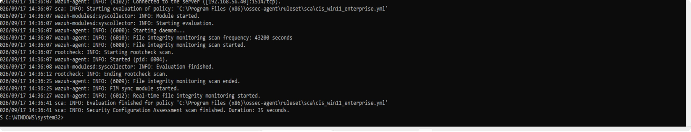
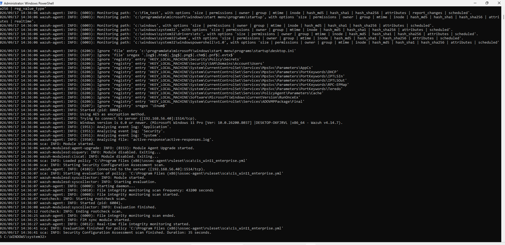
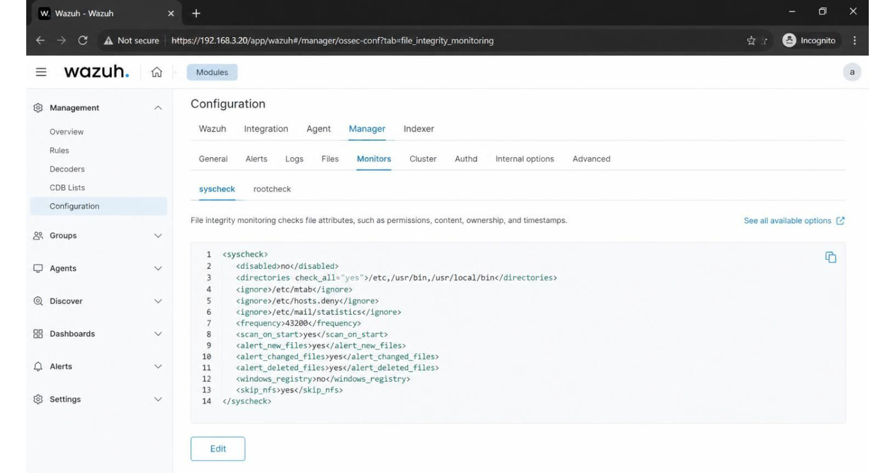
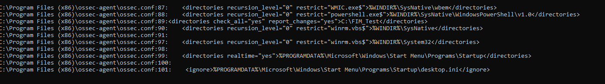
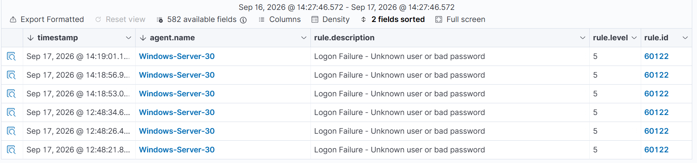
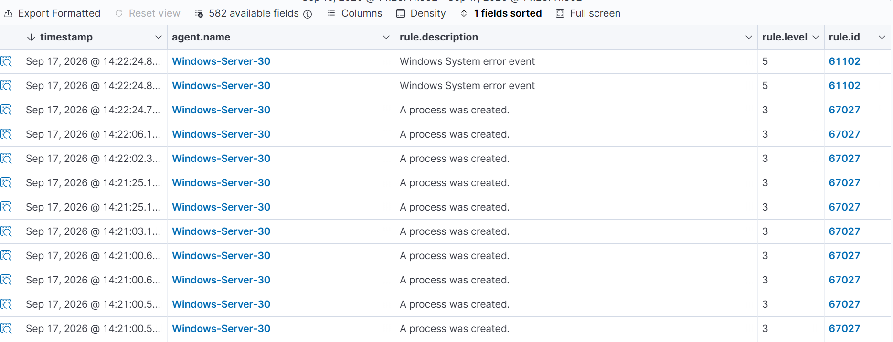
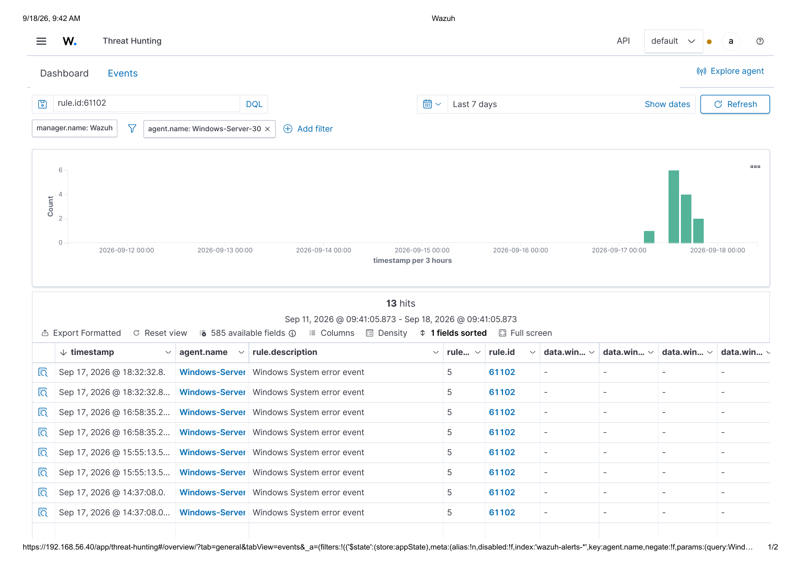
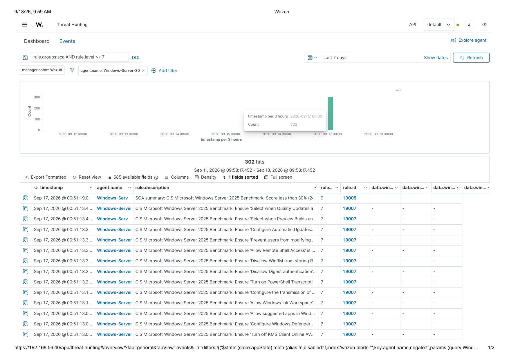

# Stages 4–5 — SIEM Deployment & Windows Log Forensics (Wazuh)

## Objective

Deploy a SIEM against both Windows hosts, **prove** (not assume) that it's actually capturing what it claims to, then use that validated telemetry to analyze six categories of security-relevant activity and surface root-caused findings.

## Part 1 — Deployment, validated live

A Wazuh manager/indexer/dashboard stack was deployed with an agent on each Windows host. Three capabilities were validated by generating a real event and confirming it appeared, correctly classified, in the dashboard — not by configuration review alone:

| Capability | How it was validated |
|---|---|
| Authentication logging | Deliberately triggered failed and successful logons; confirmed both event types appear under their correct rule IDs |
| File Integrity Monitoring (FIM) | Performed a live add → modify → delete sequence against a monitored test directory and confirmed all three event types fired in the correct order |
| SCA / CIS compliance scanning | Waited out a full compliance scan cycle against each host's applicable CIS benchmark and confirmed results populated |

**Why validate first:** a misconfigured SIEM that reports nothing wrong is indistinguishable from a quiet, secure environment. You have to prove the microphone is on before you trust the silence — everything in Part 2 depends on this validation having actually passed.

*Agent startup log — connects to manager, starts real-time FIM, completes SCA scan.*

### Investigative win: FIM wasn't declared working, it was root-caused

The client host initially showed **zero** real-time FIM events on its monitored test directory — easy to misread as "the agent is broken." Instead of assuming that, the client's config entry was diffed line-by-line against the server's own (proactively correct) entry for the same monitoring feature. The entire difference was one missing attribute: the client's directory entry was missing the real-time flag, defaulting it to a 12-hour scheduled scan instead of real-time monitoring. Fixed with an elevated config edit and a service restart, then re-validated the full add/modify/delete sequence to confirm.

**Takeaway:** the directory *was* being monitored — just on a 12-hour cycle, not real-time. A glance at the config without checking the actual timing semantics would have missed this entirely.

## Part 2 — Log analysis: six categories, all via direct query (not a guessed rule ID)

All six categories below were analyzed by querying the SIEM directly rather than assuming what a given control should show.

### 1. Logon pattern — reads as manual testing, not an attack

Failures clustered in small, human-paced groups (3–4 attempts, seconds apart), each immediately followed by success against the same single known account — no username enumeration occurred. Volume and timing are what distinguish this from a real attack: a genuine brute-force or credential-stuffing run shows far higher volume at sub-second intervals, typically against multiple usernames. This is a read of the signature the data shows, not a claim of certainty about intent.

Two gaps were flagged regardless of how benign the activity looked: **no account lockout policy exists** on either host, and **every logon observed was console-only** — no remote (RDP/WinRM) logon was ever captured, despite WinRM being the server's only network-exposed service. Good analysis separates "what happened" from "what controls are missing regardless of what happened."

### 2. Account/privilege changes — confirmed absence, not missing data

Zero hits for privilege-escalation-related event IDs on either host. This absence was confirmed as genuine (the SIEM is validated and working, per Part 1) rather than assumed to be a logging gap.

### 3. Process execution — a visibility gap, confirmed not assumed

Process-creation events appeared on the server but **zero times** on the client, despite constant routine process activity on both machines. Rather than report this as an unexplained anomaly, the audit policy was checked directly on both hosts (`auditpol /get /subcategory:"Process Creation"`): the server showed the subcategory enabled, the client showed it never enabled at all — most likely an artifact of how the lab was originally provisioned. Documented as a finding for remediation rather than fixed live, since the brief was to analyze and report, not remediate in place.

### 4. Service reliability — one explained, one not

Both hosts logged the same system-error event type, 13 times each — but the patterns tell different stories. The client's 13 events sit entirely inside a 43-minute window of active configuration work (fully explained, no ongoing concern). The server's 13 events spread across 10.5 hours in seven paired bursts — and two of those bursts occurred *after* FIM was already confirmed stable, with no further configuration changes made. That timing rules out the same explanation. This is flagged as worth investigating further (possible VM resource constraint) rather than forced into an explanation that doesn't fit the data.

### 5. Defender / Firewall configuration

Neither host had Windows Firewall connection logging configured on any profile — no audit trail exists for blocked or allowed connections. The client was additionally missing several Defender SmartScreen and Application Guard controls.

### 6. CIS / SCA compliance — the headline finding

**Both hosts score under 30% against their applicable CIS benchmark.** This is the direct counterpoint to Stage 2's clean network scan: the perimeter was hardened, but OS-level configuration hardening never caught up. The failing controls aren't random — on the server, the failing controls are specifically WinRM-related (Digest authentication allowed, Remote Shell Access allowed, RunAs credential storage not disallowed), and WinRM is the one service this server exposes to the rest of the lab network (the environment is host-only and not internet-facing, so "exposed" here means reachable by another host on that same segment, not from the internet). The compliance gap directly weakens the one administratively-reachable pathway into this host. Other failing controls tie directly into the findings above: PowerShell Transcription failing reinforces the process-visibility gap, and failed password-history enforcement on the client compounds the lockout-policy gap.

## Recommendations (priority order)

| Priority | Control |
|---|---|
| 1 | Harden WinRM on the server — disable Digest auth, restrict Remote Shell Access, disallow RunAs credential storage |
| 2 | Enable Windows Firewall connection logging on both machines |
| 3 | Enable Process Creation auditing and command-line logging on the client, matching the server |
| 4 | Enable PowerShell Script Block / Transcription logging on both machines |
| 5 | Implement an account lockout policy |
| — | Also: enforce password history on the client; investigate the server's recurring reliability events; validate remote-logon (RDP/WinRM) event capture, not just console; build a phased plan for the broader 300+ control compliance gap rather than attempting a full pass at once |

Ordering logic: WinRM hardening is #1 because it's the server's only network-exposed attack surface within this lab; firewall and process/PowerShell logging (#2–4) are the audit trail that would let you detect misuse of that same exposure; account lockout is #5 because, even though the observed activity looked benign, the absence of a lockout policy is a real gap regardless of what was actually observed.
