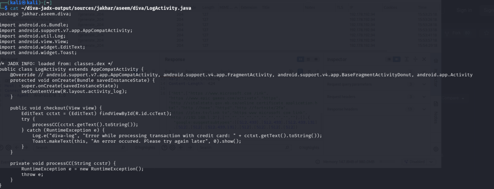
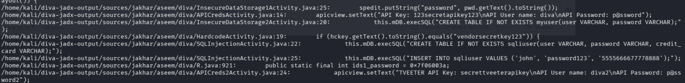
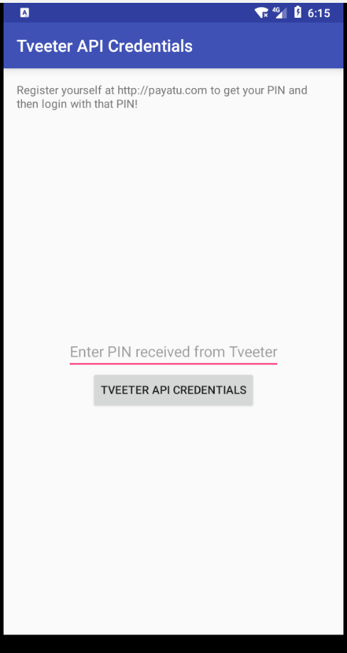
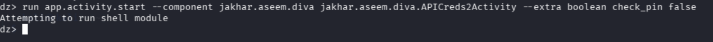
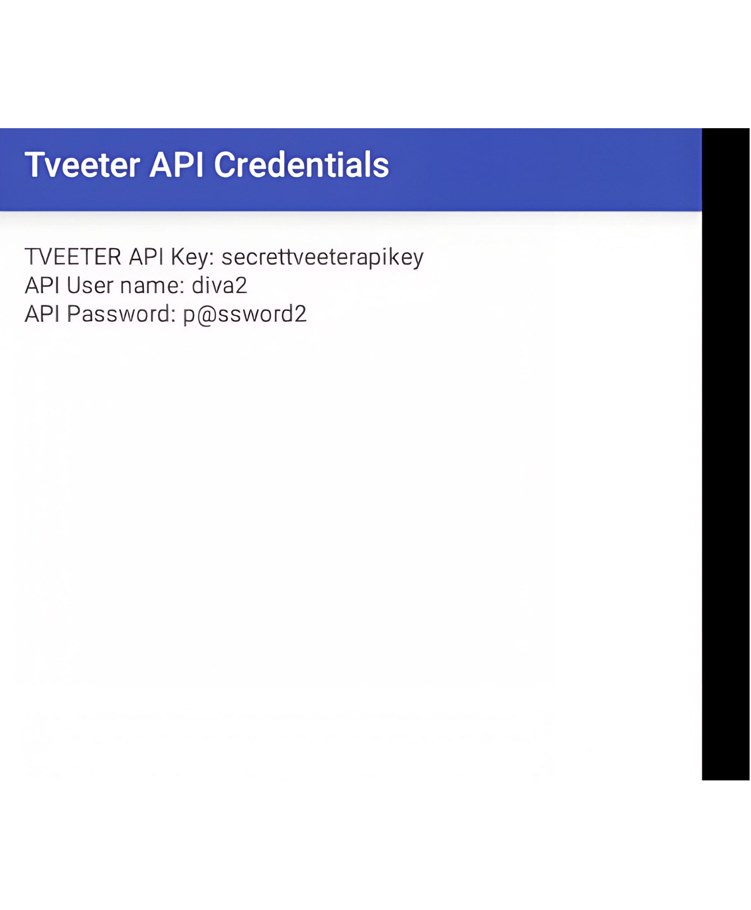
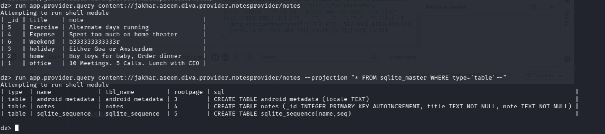
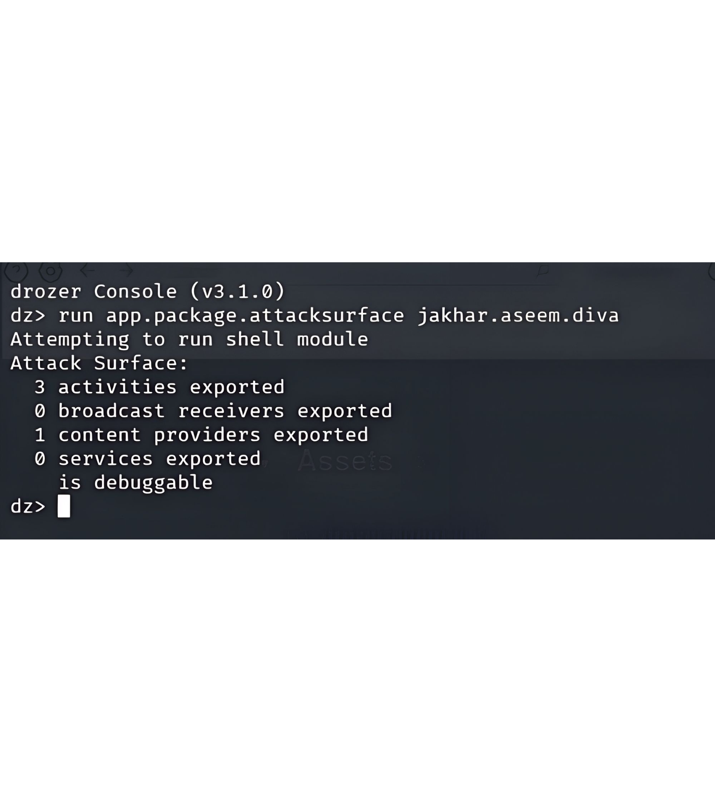

# Stage 6 — Mobile Application Security (DIVA)

## Objective

Perform static and dynamic security analysis of a deliberately vulnerable Android application, proving exploitability with working proof-of-concept evidence rather than asserting it from source review alone.

## Target & environment

**DIVA** (Damn Insecure and Vulnerable App) was chosen as the target — no specific app was named in the brief, and DIVA is the most widely used Android training app for this purpose, covering distinct vulnerability classes that map cleanly to a findings-based report.

- Android virtual device on Genymotion (API 26, chosen to match DIVA's pre-scoped-storage expectations), networked into the same lab environment as the rest of the project.
- Static analysis: **jadx** (decompile APK to readable Java) and **apktool** (unpack resources/manifest/smali) to identify hardcoded secrets, insecure logic, and manifest-level exposure.
- Dynamic analysis: **drozer**, used to confirm each static finding by acting exactly as an unprivileged third-party app on the device would — the step that turns "this looks exploitable" into "this is exploitable."

A scope note: Burp Suite network-traffic interception was attempted but descoped after the emulator's networking proved unreliable. This didn't materially limit coverage, since every DIVA challenge used here is local (logging, storage, hardcoding, access control, provider-based injection) rather than network-traffic-based.

## Findings

| # | Finding | Severity |
|---|---|---|
| 1 | Insecure logging — credit card number to logcat | High |
| 2 | Hardcoded credentials across multiple activities | High |
| 3 | Insecure data storage — plaintext password/card data | High |
| 4 | Access control — PIN bypass via a trusted Intent extra | **Critical** |
| 5 | SQL injection via an exported, unprotected content provider | **Critical** |
| 6 | Debuggable production build | Medium |

### 1. Insecure logging (High)

A checkout function is written to unconditionally throw an exception on every single attempt — not an edge case, every call — which routes execution into a handler that logs the full, unredacted card number via `Log.e()`. Any app with log-read access, or a developer with `adb logcat`, recovers the card number with zero further exploitation. Lesson: sensitive financial data should never reach application logs in any form, redacted or not.

### 2. Hardcoded credentials (High)

Static review of the decompiled source located API keys, usernames, and passwords embedded directly in three separate activity files — all recoverable in minutes with jadx, using nothing but the public install file. These secrets ship identically to every install and can't be rotated without a new release. "It's compiled, not readable" is not a real protection against a five-minute decompile.

### 3. Insecure data storage (High)

Plaintext password and credit card data were found persisted in SharedPreferences and a local SQLite database — recoverable by anything with filesystem access to the app's private data (see Finding 6, which directly enables this).

### 4. Access control — PIN bypass via a trusted Intent extra (Critical)

This is the flagship finding. An activity is supposed to require a PIN (obtained from a fake "registration" flow) before displaying a set of API credentials. The decompiled `onCreate()` reveals why that control fails: it reads a boolean extra from the launching Intent and, if that extra is explicitly `false`, displays the credentials immediately — no PIN screen, no internal verification. Since the activity is exported (confirmed via drozer's attack-surface scan), any other component — or an external tester with ADB/drozer access — can launch it directly with that crafted extra.

**Reproduction:**
1. Confirm the extra's key name from the app's string resources.
2. Force-stop the app, so the next launch triggers a fresh `onCreate()`.
3. Launch the target activity via drozer with the extra explicitly set to `false`.

Result: the credentials screen renders immediately, with zero PIN ever entered — a reproduced exploit, not an inferred one.

**Core lesson:** never let a security decision depend on a value the caller supplies. Verify state internally or do it server-side.

### 5. SQL injection via an exported, unprotected content provider (Critical)

A content provider is exported with no read or write permission set at all, and drozer's injection scanner confirmed both its projection and selection parameters are unsanitized. A UNION-style payload against the projection parameter dumped the entire `sqlite_master` schema. Two facts stack here: the provider is reachable by any app with zero permissions requested, *and* its parameters are injectable, not just readable. In this specific app the provider's database only held one table, but the primitive is proven and severe — a provider exposed this way backing real sensitive tables would allow silent exfiltration.

### 6. Debuggable production build (Medium)

`android:debuggable="true"` was confirmed on a non-development build (via the same drozer attack-surface module used for Finding 4), allowing debugger attachment and `adb shell run-as` access to the app's private data — directly reaching the data from Finding 3 without needing the content-provider route at all. Fix is simple: `debuggable=false` in the release build config, enforced by the CI/release pipeline rather than left to manual toggling.

## Recommendations (priority order)

| Priority | Finding | Control |
|---|---|---|
| 1 | Access Control | Never let a security decision depend on caller-supplied data — verify server-side or re-check state internally |
| 1 | SQL Injection | `android:exported="false"` unless required; enforce a signature permission; use parameterized queries |
| 2 | Insecure Storage | Encrypt sensitive fields (e.g. EncryptedSharedPreferences / SQLCipher); avoid storing raw card data at all |
| 2 | Insecure Logging | Remove logging of sensitive fields, or redact before it reaches `Log.*()` |
| 3 | Hardcoding | Remove hardcoded secrets from source; retrieve at runtime and rotate shipped values |
| 3 | Debuggable Build | `android:debuggable="false"` in release config; enforce via CI |

The two Critical findings tie for top priority since both are directly, remotely exploitable by any unprivileged app requesting zero special permissions. The recurring theme across every control here: validate trust boundaries server-side or internally — never rely on the client, the caller, or a build-time flag alone.
